Links:

https://appliedguitartheory.com/lessons/a-minor-pentatonic-scale/

https://www.oolimo.com/

If we compare a piano keyobard to a guitar fretboard we have the following.

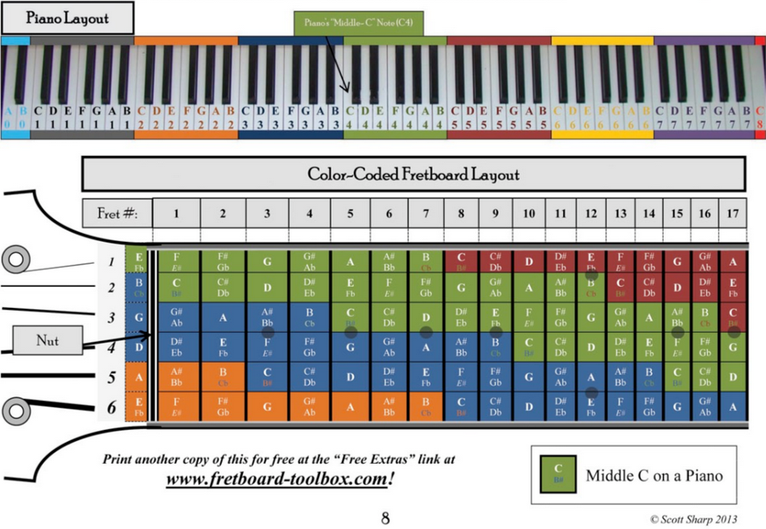

Notice the pattern for octaves.

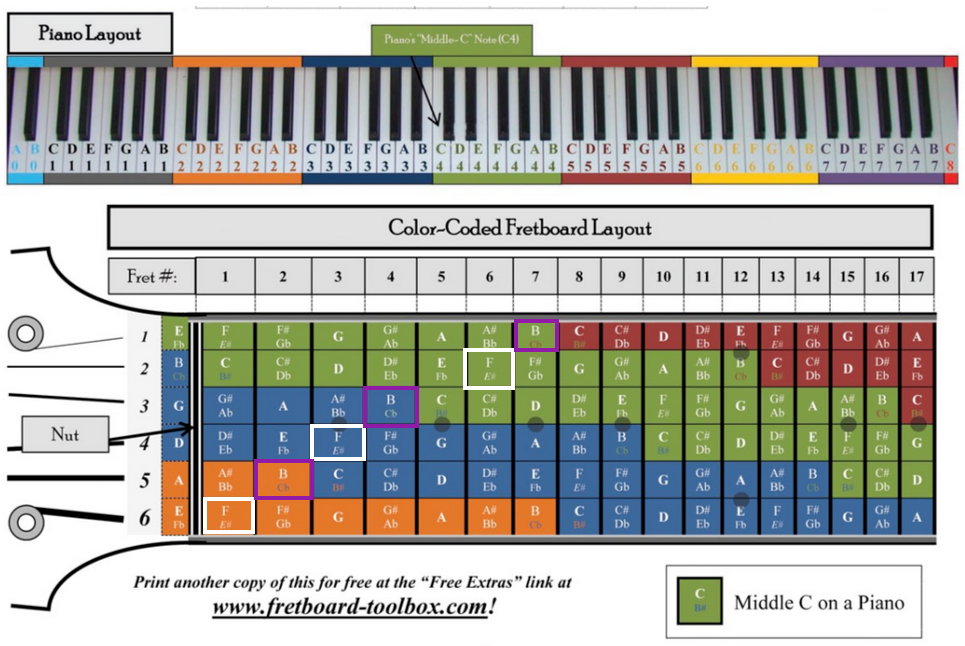

Playing C-major scale across a string

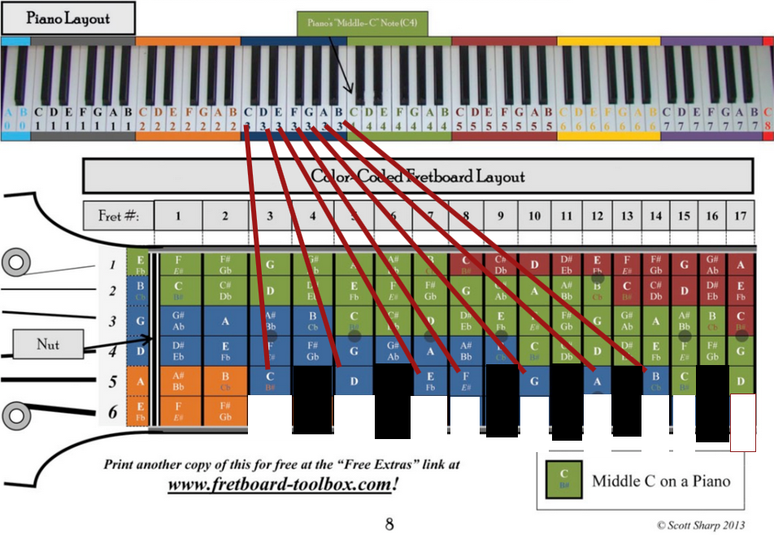

Minor scale.

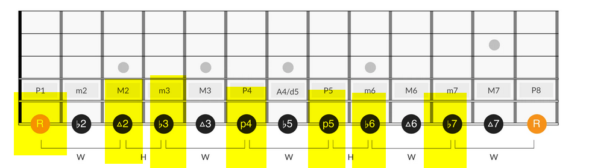

Minor scale Back in Black.

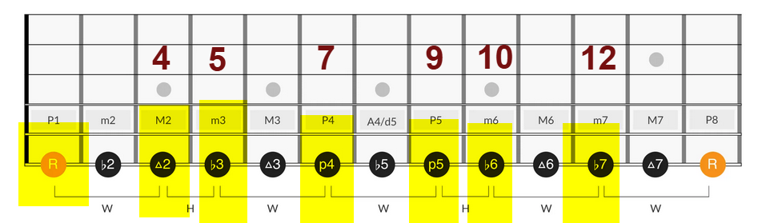

Minor pentatonic scale.

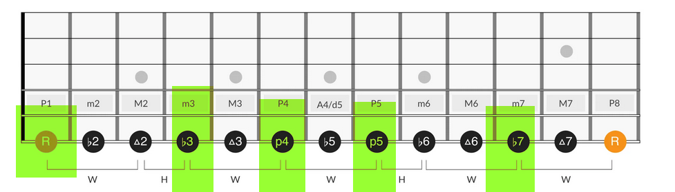

Minor pentatonic scale Fretboard.

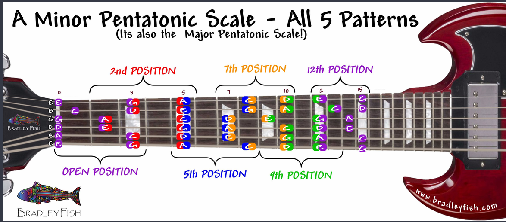

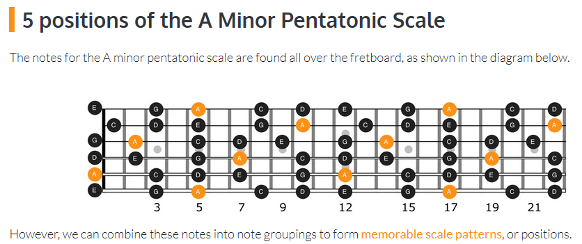

Minor pentatonic scale position 1.

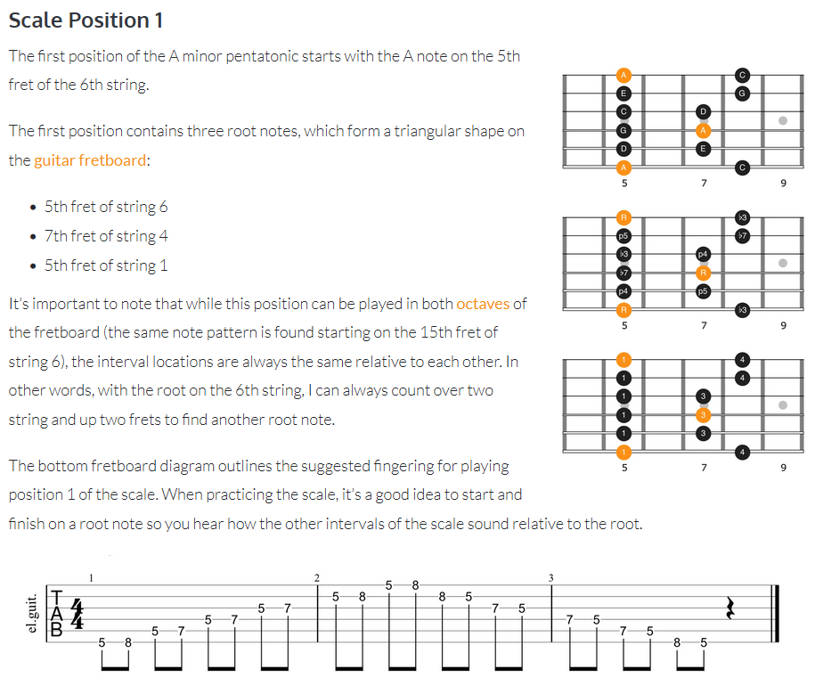

Minor pentatonic scale position 1. No Woman No Cry

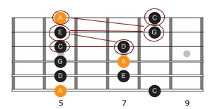

<h3>Let There Be Rock - AC/DC</h3>

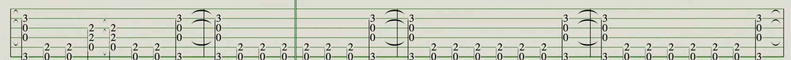

<h3>Whole Lotta Rosie - AC/DC</h3>

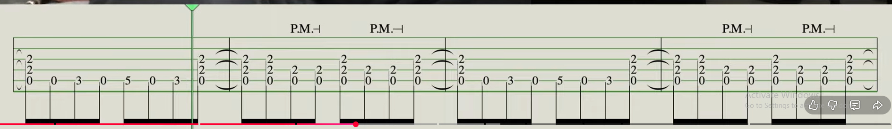

<iframe src="fretboard.html" width="900" height="350" style="border:none;"></iframe>
