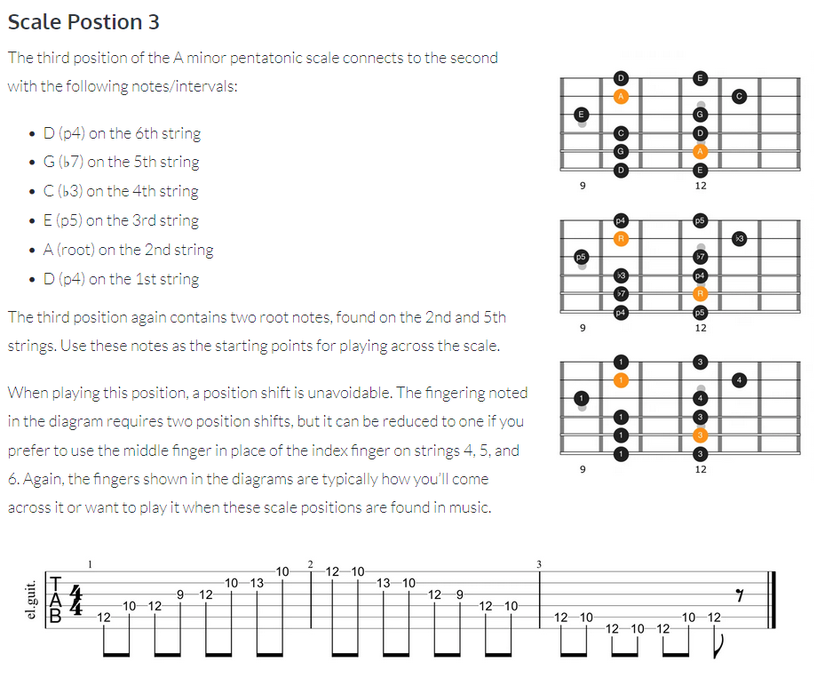
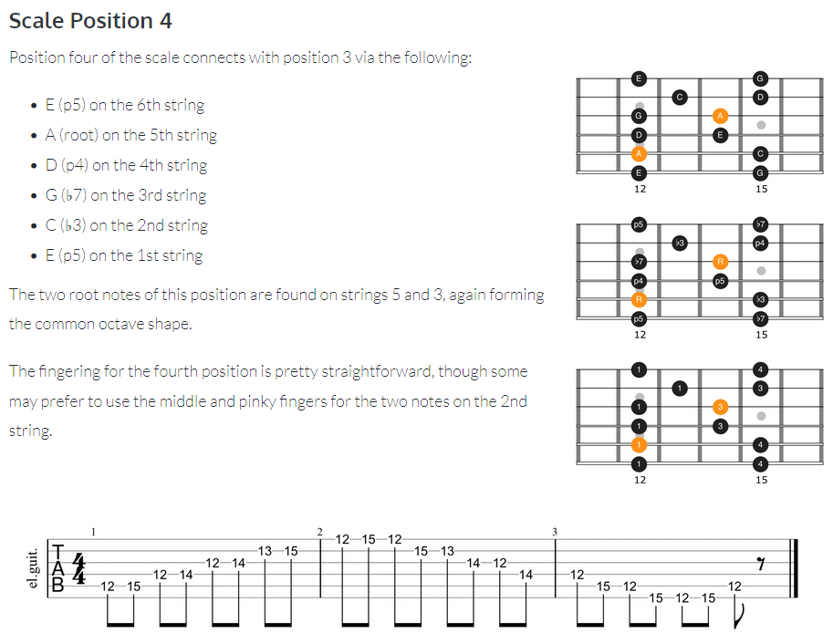

Links:
https://appliedguitartheory.com/lessons/a-minor-pentatonic-scale/
https://www.oolimo.com/en/chord-types/maj7

If we compare a piano keyobard to a guitar fretboard we have the following.

Notice the pattern for octaves.

Playing C-major scale across a string

Minor scale.

Minor scale Back in Black.

Minor pentatonic scale.

Minor pentatonic scale Fretboard.

Minor pentatonic scale position 1.

Minor pentatonic scale position 1. No Woman No Cry

Minor pentatonic scale position 3

Minor pentatonic scale position 4

<iframe src="fretboard.html" width="900" height="350" style="border:none;"></iframe>
